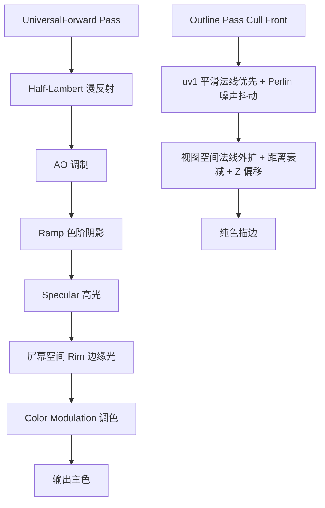

# ZZZ 角色 Toon Shader —— 设计思路总结

> 本文件归纳项目内手写 URP 卡通着色器的整体设计，便于复习与接手。
> 核心着色器：`Assets/Shader/ZZZ_body.shader`、`Assets/Shader/ZZZ_face.shader`、`Assets/Shader/ZZZ_face_sdf.shader`（脸部皮肤专用，阴影子系统与 Body 一致）
> 开发/测试着色器：`Assets/Scenes/Outline_Test.shader`、`Assets/Scenes/Tool_Test.shader`
> 工具着色器（烘焙）：`Assets/Editor/BakeSmoothNormalObjectSpace.shader`
> 配套工具：`Assets/Editor/RampEditorWindow.cs`（Ramp 生成）、`Assets/Editor/SmoothNormalToUV2.cs`（平滑法线写入）、`Assets/Editor/NormalSmoothingTool.cs`（平滑法线烘焙贴图）、`Assets/Scripts/huidu.cs`（顶点色查看）

---

## 0. 设计目标

面向《绝区零》风格角色（MMD 导入模型）的二次元卡通渲染，目标效果：

- **硬边 + 多级色阶阴影**（非平滑渐变），用 Ramp 贴图统一控制明暗色相；
- **屏幕空间轮廓感边缘光**（Rim），且不被模型内部杂乱法线污染；
- **距离无关的屏幕空间描边**（Outline）：近处/远处粗细一致、可调抖动、硬边/UV 缝合处不裂；
- **美术可驱动**：阈值、软硬、强度、颜色全部暴露为材质参数 + Ramp 贴图工作流。

---

## 1. 渲染管线与整体架构

| 项 | 选择 | 原因 |
|---|---|---|
| 管线 | URP (Universal Render Pipeline) | 手写 `HLSLINCLUDE` 公共块，仅包含 `Core / Lighting / DeclareDepthTexture` 三个库 |
| 着色器 | 纯手写 HLSL（非 ShaderGraph） | 精细控制 Ramp / 屏幕深度 Rim / 描边膨胀 |
| Pass 数 | **2 Pass**：Forward + Outline | 主色与描边分离，描边用 `Cull Front` 背面膨胀法 |
| 着色器拆分 | `ZZZ_body` / `ZZZ_face` / `ZZZ_face_sdf` 三份 | 身体走完整管线（Ramp/Rim/Specular/AO）；脸部非皮肤件（眼/嘴/眉等）走简化管线（仅 Half-Lambert³ + 描边）；脸部皮肤 `ZZZ_face_sdf` 复用 **Body 的阴影管线**（Half-Lambert² + AO + Ramp），但不做 Specular / Rim / 调色 |
| SRP 兼容 | 所有材质参数包进 `CBUFFER_START(UnityPerMaterial)` | 保证 SRP Batcher 合批，避免逐材质 SetPass 开销 |
| 关键字 | `_USE_RAMPMAP`、`_USE_OUTLINE_NOISE` 用 `shader_feature_local` | 变体按需编译；关闭 Ramp / 关闭噪声时零成本 |

**关于其它两个「声明但未真正生效」的开关（重要，避免误读）：**

- `_USE_RIM_LIGHT`：在 `ZZZ_body` 的 `HLSLINCLUDE` 中 `#pragma shader_feature_local _USE_RIM_LIGHT` 已声明，但 Rim 计算**没有任何 `#if defined(_USE_RIM_LIGHT)` 分支包裹**——当前 Rim 恒开，该关键字只是占位、不产生实际变体差异。若日后要做「开关边缘光」需补 `#if` 守卫。
- `_USE_AO_MAP`：Properties 里是 `[Toggle(_USE_AO_MAP)] _UseAOMap`，但**没有**对应的 `#pragma shader_feature_local _USE_AO_MAP`，也没有 `#if defined` 守卫。AO 实际是运行时 uniform 开关：在 frag 里 `ao = lerp(1.0, ao, _AOIntensity * _UseAOMap)`——`_UseAOMap` 恒为 0 或 1 的常量，靠 uniform 混合强弱，而非变体剥离。所以「关 AO」只是把混合权重压到 0，并非剔除 AO 采样指令。

**Pass 结构（Body）**



> 与经典实现不同：**描边粗细不由顶点色 G 通道控制**（旧版本写法，已被移除），而是由「uv1 平滑法线保证连贯性」+「Perlin 噪声做粗细抖动」两者决定，见 §6.2 / §6.3。

---

## 2. 光照模型：Half-Lambert + 幂次 Toon 化

漫反射不使用标准 Lambert，而采用 **Half-Lambert（半兰伯特）** 把背光面也提亮，再用幂次把过渡"压硬"成卡通色阶：

```hlsl
half NdotL       = saturate(dot(N, L));
half halfLambert = saturate(NdotL * 0.5 + 0.5);   // 值域 [0,1]，背光面不再纯黑
halfLambert      = halfLambert * halfLambert;     // Body：平方（^2），增强对比
// Face：halfLambert = halfLambert * halfLambert * halfLambert;  // 立方（^3），更"硬"
```

**设计要点**：幂次越高，明暗交界越锐利、中间调越少，越接近赛璐璐。Body 用 ^2 保留皮肤过渡，Face 用 ^3 让面部阴影更干净（面部通常不做 Ramp，靠 ^3 的硬过渡 + 单独描边区分）。

> **`ZZZ_face_sdf`（脸部皮肤，材质 `face/0._.mat`）例外**：它不沿用 `ZZZ_face` 的 ^3 简化管线。明暗来源是**面部 SDF 阈值判断**（见 §3.4），下游管线（AO、Ramp 阶调色）照搬 Body 的写法；把 `_USE_FACE_SDF` 关掉则完整退回 Body 的 N·L 管线（^2 Half-Lambert → AO 调制 → `(ambient + halfLambert) * 0.5` 重映射 → Ramp）。脸部材质因此暴露 `_AOMap` / `_RampMap` / `_RampID` / `_Shadow*` / `_FaceSDF` 等 Body 与 SDF 两套参数。
>
> 脸部用法：`_RampMap` 挂 `TEXTURES/getpifuramp.png`（2 行皮肤 Ramp，Point 采样）。`_RampID` 不挂贴图时为默认白色 → `GetrampV` 返回 v=0.3 → 恒定采第 0 行（按 `floor(0.3×2)=0` 落在 row 0，不会串行）；若挂上 `tex/rampID_fa.png`（绿/蓝两色遮罩，绿→v=0.5、蓝→v=0.3），2 行 Ramp 下的 v=0.5 恰在第 0/1 行交界，会随实现落到 row 1，需要多行 Ramp 才稳。`_AOMap` 脸部暂无专用贴图，保持默认白色 = 关 AO（行为同 Body 把 `_UseAOMap` 置 0）。

---

## 3. 核心系统：Ramp 色阶阴影

这是整套设计的灵魂——用**一张二维 Ramp 贴图**同时编码「光照梯度」与「材质/部位分层」。

### 3.1 二维 Ramp 贴图的 UV 语义

```
RampMap (横向 U × 纵向 V)
  U 轴 = 光照强弱（从暗到亮），由 smoothstep 生成
  V 轴 = 色阶层 / 部位 ID，由 RampID 遮罩选择
```

- **横向 U（rampU）**：由 Half-Lambert 经 smoothstep 得到，控制阴影边界的**软硬**：
  ```hlsl
  half rampU = smoothstep(_ShadowThreshold - _ShadowSoftness,
                          _ShadowThreshold + _ShadowSoftness,
                          halfLambert);
  ```
  `_ShadowThreshold` 是明暗交界位置，`_ShadowSoftness` 越小边界越硬（卡通感越强）。

- **纵向 V（rampV）**：由 **RampID 遮罩贴图** 的 RGB 通道查表得到。RampID 是一张手绘遮罩，不同颜色区域代表不同阴影层级：

  ```hlsl
  half GetrampV(half3 rampIDtu)
  {
      half v = 0.1;                                    // 默认层
      v = lerp(v, 0.9, step(0.6, rampIDtu.r));         // R 通道 → 顶层
      v = lerp(v, 0.5, step(0.6, rampIDtu.g));         // G 通道 → 中层
      v = lerp(v, 0.3, step(0.6, rampIDtu.b));         // B 通道 → 底层
      return v;
  }
  ```
  即：RampID 的 **R>0.6** 选 V=0.9 行、**G>0.6** 选 V=0.5、**B>0.6** 选 V=0.3，否则用默认 V=0.1。这样美术可以在 RampID 贴图上用纯色笔刷把角色不同部位（头发/身体/衣服）指向 Ramp 贴图不同行的配色，实现**一贴图多套阴影色**。（项目中 `Assets/Models/.../tex/rampID_ti.png` 与 `rampID_fa.png` 即身体/脸部的 RampID 遮罩。）

### 3.2 合成

```hlsl
half3 RampID     = SAMPLE_TEXTURE2D(_RampID, sampler_RampID, i.uv0);
half2  rampUV    = half2(rampU, GetrampV(RampID));
half3  rampColor = SAMPLE_TEXTURE2D(_RampMap, sampler_RampMap, rampUV).rgb;
// 用 Ramp 颜色对主色做阴影调色，_ShadowIntensity 控制强弱（受 _USE_RAMPMAP 守卫）
color = lerp(color, color * rampColor, _ShadowIntensity);
```

### 3.3 AO 与阴影的耦合

```hlsl
half ao     = SAMPLE_TEXTURE2D(_AOMap, sampler_AOMap, i.uv0);
ao          = lerp(1.0, ao, _AOIntensity * _UseAOMap);   // 1=无AO，ao 越小遮蔽越强
half ambient = halfLambert * ao;
half shadow  = (ambient + halfLambert) * 0.5;            // AO 与光照各半混合
shadow       = lerp(shadow, 0,  step(shadow, 0.05));     // 压死暗部
shadow       = lerp(shadow, 1,  step(0.95, shadow));     // 提亮亮部
```

> 注意：`_UseAOMap` 是运行时 uniform（见 §1），不是 shader keyword，关掉只是把混合权重压到 0。

### 3.4 面部 SDF 阴影（`ZZZ_face_sdf` 专用）

脸部若用 N·L 决定明暗，交界会随低模面片法线抖动（鼻梁被硬线劈开）。`ZZZ_face_sdf` 改用**面部 SDF 贴图 + 阈值比较**：SDF 只负责判断「这里算受光还是阴影」，**不参与任何颜色计算**。

- **SDF 值语义**：`0` = 鼻梁/鼻尖（最早入影）~ `1` = 脸颊边缘（最晚入影）；贴图按**右侧光**单侧烘焙。
- **导入设置**：线性（关 sRGB）+ Wrap = Clamp。当前挂在 `Assets/TEXTURES/wow.png`（材质的 `_FaceSDF`）。
- **阈值公式**（不旋转 UV，只做比较）：

```hlsl
threshold = saturate((1 - FdotL) * 0.5 + UdotL * _FaceUpFactor + _FaceShadowOffset);
mask      = smoothstep(threshold - softness, threshold + softness, sdf);  // 1=受光 0=阴影
```

正脸光 → `threshold = 0` → 全亮；正背光 → `threshold = 1` → 全暗。`_FaceUpFactor` 让顶光推高阈值（脸更易入影）、底光拉低；`_FaceShadowSoftness` 只是比较带宽（防锯齿），不是「用 SDF 做渐变」。

- **镜像**：贴图按右侧光烘焙，`RdotL < 0`（光从角色左侧来）时翻转 `UV.x`，保证左右对称。
- **头部三轴**：`_HeadForward` / `_HeadRight` 为模型空间轴（默认 +Z / +X），经物体矩阵转世界空间；上轴由 `faceUp = cross(faceForward, faceRight)` 推出。
- **与 Body 的关系（重点）**：SDF **只替换 body 阴影管线里的那一个输入量 `halfLambert`**，下游逐行照搬 body——AO 调制 → `(ambient + halfLambert) * 0.5` 重映射 → 0.05/0.95 硬切 → `rampU = smoothstep(_ShadowThreshold ± _ShadowSoftness, halfLambert)` → `color = basecolor × light.color × shadow` → `lerp(color, color × rampColor, _ShadowIntensity)`，一个字符都没改。
  - 为什么中间要做一次映射：body 的 `halfLambert = saturate(NdotL*0.5+0.5)²` 值域是 `[0.25, 1]`（半兰伯特把背光面抬到 `0.5²`），而 SDF 输出的是二值判断。把 0 直接喂进 body 的链子会得到 `shadow = 0` → 整块乘成全黑，所以把「受光 = 1 / 阴影 = 0.25」映射回 body 实际能取到的同一区间：`halfLambert = lerp(0.25, 1.0, faceMask)`。这样阴影端的压暗程度、AO 耦合、Ramp 阈值全部与 body 同源。
- **面部阴影遮罩**（`_FaceShadowMask`，R 通道，可选）：**黑 = 映射为阴影**、白 = 保持原明暗、灰 = 部分强度，同样是拉向 body 的阴影下限：`halfLambert = lerp(0.25, halfLambert, mask)`。默认白图 = 无影响；`_USE_FACE_SHADOW_MASK` 关闭则整段采样被剔除。它作用在明暗输入上，SDF 与 N·L 两条分支共用同一处。
- **亮面亮度**（`_FaceLitIntensity`，默认 1）：只作用于受光侧的乘算——权重取明暗输入在 body 值域 `[0.25, 1]` 内归一化后的值（SDF 模式下即 0/1），所以 `>1` 提亮亮面、`<1` 压暗亮面，**阴影侧完全不受影响**。默认 1 时与 body 无任何差异。
- **调试**：`_DebugMode` 5 = SDF 采样值（含镜像后的 UV）、6 = 受光遮罩、7 = 遮罩贴图采样值，用来核对烘焙方向、镜像与遮罩是否符合约定。
- **回退**：`_USE_FACE_SDF` 关闭时**只有 `halfLambert` 的赋值**换回 `saturate(NdotL * 0.5 + 0.5)²`，下游管线不变。

### 3.5 Ramp 贴图生成器（工具）

`Assets/Editor/RampEditorWindow.cs` 提供 `Tool/Ramp Generator` 菜单，用 `Mathf.SmoothStep` 在 `width ± softness` 区间做横向过渡，按 `Light/Shadow` 两色 `Lerp` 生成 `Assets/TEXTURES/ramp.png`。设计意图：让美术**不进 PS** 就能快速试不同阈值/软硬的 Ramp。

---

## 4. 高光 Specular

走**贴图驱动的高光区域 + 阈值截断**，而非物理高光模型：

```hlsl
if (halfLambert > 1 - _SpecularRegion)   // 只在亮区 > (1-Region) 出现高光
{
    color.rgb = lerp(color.rgb,
                     lerp(color.rgb, color.rgb + specularMap.a, halfLambert),
                     _SpecularPower);
}
```
- `SpecularMap.a`：高光形状遮罩（白=有高光区域）；
- `_SpecularRegion`：高光覆盖范围（越大越广）；
- `_SpecularPower`：高光强度。

---

## 5. 屏幕空间深度边缘光 Rim（关键创新点）

不是传统「菲涅尔 × 阈值」的 Rim，而是**在屏幕空间做深度边缘检测**，能贴着模型与背景/自身交界的轮廓发光，且用菲涅尔做二次遮罩剔除内部杂光。

```hlsl
// 1. 观察空间下，沿法线 XY 偏移一个采样点
float3 samplePositionVS = float3(positionVS.xy + normalVS.xy * _RimWidth, positionVS.z);
// 2. 偏移点 → 裁剪 → 视口 UV
float4 samplePositionCS = mul(UNITY_MATRIX_P, float4(samplePositionVS, 1.0));
float4 samplePositionVP = TransformHClipToViewPortPos(samplePositionCS);
// 3. 采样偏移处深度（SAMPLE_TEXTURE2D_X 兼容 VR）
float offsetDepth       = SAMPLE_TEXTURE2D_X(_CameraDepthTexture, sampler_CameraDepthTexture, samplePositionVP.xy).r;
float linearEyeOffsetDepth = LinearEyeDepth(offsetDepth, _ZBufferParams);
// 4. 自身深度
float linearEyeDepth    = LinearEyeDepth(i.positionCS.z, _ZBufferParams);
// 5. 深度差判定：偏移处比自身"远" → 说明法线那侧是空洞/背景 → 判定为轮廓
float depthDiff     = linearEyeOffsetDepth - linearEyeDepth;
float rimIntensity  = step(_DepthThreshold, depthDiff);

// 6. 菲涅尔遮罩：剔除朝向相机的内部面（避免身体中间也发光）
float3 viewDirectionWS = SafeNormalize(GetCameraPositionWS() - i.positionWS);
float rimRatio = 1.0 - saturate(dot(viewDirectionWS, i.normalWS));
rimRatio       = pow(rimRatio, exp2(lerp(4.0, 0.0, _FresnelMask)));
rimIntensity   = lerp(0.0, rimIntensity, rimRatio);

color.rgb += _RimColor.rgb * rimIntensity * _RimIntensity;
```

**参数语义**
- `_RimWidth`：观察空间采样偏移量（探测半径）；
- `_DepthThreshold`：深度差阈值，越小越容易触发（轮廓越粗）；
- `_FresnelMask`：0=强菲涅尔（只留最边缘），1=弱菲涅尔（内部也允许发光）；
- `_RimColor` / `_RimIntensity`：颜色与强度。

> 设计优势：相比纯菲涅尔 Rim，这种方法在**角色被自身四肢遮挡**的轮廓处也能正确描出边缘光，且不会在正面平坦区域乱发光。
> 依赖：需 `#include "Packages/.../DeclareDepthTexture.hlsl"` 声明 `_CameraDepthTexture`，且 URP 资源里开启 Depth Texture（Body 已包含，Face 未启用 Rim）。

---

## 6. 描边系统 Outline（背面膨胀法 · 视图空间外扩）

经典 **`Cull Front` + 法线外扩**，但做了四层精细化。`ZZZ_body` / `ZZZ_face` 共用同一套 Outline Pass 逻辑（含 uv1 平滑法线）；`Outline_Test` / `Tool_Test` 是简化版（直接用法线 `normalOS`，无 uv1，仅用于孤立调试描边参数）。

### 6.1 视图空间法线外扩（核心数学）

```hlsl
VertexPositionInputs posInputs = GetVertexPositionInputs(v.positionOS.xyz);
float3 positionVS = posInputs.positionVS;
// 平滑法线优先（见 §6.2），回退到硬法线
float3 smoothNormalOS = dot(v.uv1, v.uv1) > 1e-6 ? v.uv1 : v.normalOS;
float3 normalVS = normalize(TransformWorldToViewDir(TransformObjectToWorldNormal(smoothNormalOS)));

float outlineWidth = _OutlineWidth * noiseFactor;     // noiseFactor 见 §6.3

float viewDepth = -positionVS.z;                       // 观察空间深度（正值）
float clampW    = saturate(_OutlineMaxDistance / viewDepth);
positionVS.xy  += normalVS.xy * outlineWidth * 0.001 * viewDepth * clampW;

o.positionCS = mul(UNITY_MATRIX_P, float4(positionVS, 1.0));
o.positionCS.z += -_OutlineZOffset * o.positionCS.w;   // 见 §6.4
```

**为什么在视图空间外扩，而不是裁剪空间 NDC 偏移：**
- 透视投影下，同一个模型空间位移在近处和远处的屏幕投影尺寸不同（约 ∝ 1/z）。若直接沿法线加固定 NDC 偏移，远处描边会「变粗」、近处「变细」，且会随相机距离漂移。
- 这里在**视图空间**沿 `normalVS.xy` 外扩后再投影，并显式乘 `viewDepth`（= `-positionVS.z`）抵消 1/z 缩放，使**屏幕空间描边宽度近似与距离无关**——近处远处一样粗。
- `0.001` 是把 `_OutlineWidth`（0~10 的"像素级"语义）映射到视图空间单位的经验缩放系数。

**Body 的细化（视图方向投影法）：** `ZZZ_body` 在取 `.xy` 前先把法线投影到「垂直于视线的平面」，去掉朝相机方向的成分，得到更纯粹的屏幕切向外扩：
```hlsl
float3 viewDirVS   = normalize(-positionVS);
float3 normalOffset = normalize(normalVS - dot(normalVS, viewDirVS) * viewDirVS);
float2 extent = normalOffset.xy;
positionVS.xy += extent * outlineWidth * 0.001 * viewDepth * clampW;
```
`ZZZ_face` 则用原始 `normalVS.xy`（轮廓更"鼓"一点）。两者差异极小，仅在偏心顶点上略有体现。

### 6.2 平滑法线（uv1）解决硬边 / UV 缝合断裂  ★核心工作流

> 这是当前描边连贯性的真正机制——**不是顶点色 G 通道**（旧写法已移除，README 历史版本曾误述）。

MMD 导入模型在 UV 缝合处、硬边、材质边界会把一个顶点**拆成多个副本**，每个副本带各自的硬法线。若直接用 `normalOS` 做背面膨胀，副本两侧的膨胀方向不一致，描边会在缝合处**开裂/锯齿**。

解决方式：烘焙一份「按位置焊接后的平均法线」写回网格的 **UV 通道 1（`TEXCOORD1`，Unity 旧 API 称 uv2）**，描边 Pass 优先用它：

```hlsl
float3 smoothNormalOS = dot(v.uv1, v.uv1) > 1e-6 ? v.uv1 : v.normalOS;
```

- `dot(v.uv1, v.uv1) > 1e-6` 是"是否已烘焙"的判断：uv1 为零向量（未烘焙）时回落到 `normalOS`，保证没跑工具也能出描边。
- 烘焙工具见 §12：`SmoothNormalToUV2.cs` 直接写网格 UV1；`NormalSmoothingTool.cs` + `BakeSmoothNormalObjectSpace.shader` 烘焙成贴图（项目里 `Assets/TEXTURES/U_Char_*_SmoothNormal_OS.png` 即产物，可用于 `_DebugMode = Smooth Normal` 预览，见 §9）。

### 6.3 Perlin 噪声抖动（物体空间采样，无缝）

```hlsl
float noiseFactor = 1.0;
#if defined(_USE_OUTLINE_NOISE)
    float2 noiseCoord = v.positionOS.xy * _NoiseTillOffset.xy + _NoiseTillOffset.zw
                        + _Time.y * _OutlineNoiseAnimSpeed;   // 沿对角线滚动坐标
    float n = applyNoiseContrast(perlinNoise2D(noiseCoord), _NoiseContrast);
    noiseFactor = 1.0 + n * _OutlineNoiseStrength;            // ∈ [1-s, 1+s]，恒正
#endif
float outlineWidth = _OutlineWidth * noiseFactor;
```

`noiseFactor ∈ [1-strength, 1+strength]`，让描边粗细随机起伏，模拟手绘 ink 抖动。

**关键细节——采样坐标用物体空间 `positionOS.xy`，不是 UV：**
- UV 在缝合处两侧的同位置副本会映射到不同 UV，采到的噪声值不同 → 描边宽度在缝合处跳变 → 再次开裂。
- 物体空间坐标是模型固有的、缝合两侧副本共享同一坐标，因此噪声天然**无缝**，与 §6.2 的平滑法线目标一致。
- `_NoiseTillOffset`：xy = 平铺密度（物体空间/米），zw = 偏移；`_OutlineNoiseAnimSpeed > 0` 时坐标沿对角线滚动，描边"流动"。
- `_USE_OUTLINE_NOISE` 关闭后整个噪声分支被编译剔除，`noiseFactor` 恒为 1（宽度均匀、零噪声开销）。

### 6.4 距离衰减 + Z 偏移

```hlsl
float clampW = saturate(_OutlineMaxDistance / viewDepth);   // 实际公式
o.positionCS.z += -_OutlineZOffset * o.positionCS.w;        // 实际公式
```

- `_OutlineMaxDistance`：衰减起点（米）。`clampW = saturate(MaxDist / viewDepth)` → 当 `viewDepth < MaxDist`（近）时比值 >1 被 saturate 到 1，**保持满粗细**；当 `viewDepth > MaxDist`（远）时比值 <1，按比例**线性变细**。注意这是"近满远细"的反比关系，而非把距离当分母直接除。
- `_OutlineZOffset`：微调描边与主体深度关系，防穿模/控遮挡。写在裁剪空间且乘 `positionCS.w`（`z` 是 pre-divide 的齐次坐标，必须 ×w 才是常数深度偏移）；URP 用 **Reverse-Z**，故**正值沉后、负值前移**。

---

## 7. 调色 Color Modulation

```hlsl
_ColourModulation  // 整体乘色（改色调，如偏暖/偏冷）
_Saturation        // 饱和度，Range(0,2)，1=原色
```
放在主色合成之后、输出之前，作为最后的统一校色层。

---

## 8. Perlin 噪声实现（轻量版）

用于描边抖动的 2D 梯度噪声，**为 SM2.0 / 移动端友好**而设计：

```hlsl
float2 hash22(float2 p)            // sin 哈希生成梯度（未归一化，幅度略不均但描边够用）
{
    p = float2(dot(p, float2(127.1, 311.7)), dot(p, float2(269.5, 183.3)));
    return -1.0 + 2.0 * frac(sin(p) * 43758.5453123);
}

float perlinNoise2D(float2 p)
{
    float2 pi = floor(p), pf = frac(p);
    float2 u  = pf*pf*pf*(pf*(pf*6.0 - 15.0) + 10.0);   // quintic（C²）衰减，消除网格接缝
    float n00 = dot(hash22(pi + float2(0.0, 0.0)), pf - float2(0.0, 0.0));
    float n10 = dot(hash22(pi + float2(1.0, 0.0)), pf - float2(1.0, 0.0));
    float n01 = dot(hash22(pi + float2(0.0, 1.0)), pf - float2(0.0, 1.0));
    float n11 = dot(hash22(pi + float2(1.0, 1.0)), pf - float2(1.0, 1.0));
    return lerp(lerp(n00, n10, u.x), lerp(n01, n11, u.x), u.y);
}

// 噪声对比度：sign(n)*|n|^(1/c)，c>1 拉开黑白、c<1 变柔和，零点结构不变
float applyNoiseContrast(float n, float c) { return sign(n) * pow(abs(n), 1.0 / c); }
```
**要点**：用 **quintic 权重** `6t⁵-15t⁴+10t³` 而非 `smoothstep(3t²-2t³)`，保证二阶连续，避免噪声网格可见接缝。`applyNoiseContrast` 让美术在不改变噪声结构的前提下，用 `_NoiseContrast` 拉开或柔化黑白差距。

---

## 9. 调试与工具链

| 工具 / 参数 | 位置 | 用途 |
|---|---|---|
| `_DebugMode` 枚举（Off=0 / Vertex Color=1 / View Normal=2 / Smooth Normal=3 / Noise=4） | `ZZZ_body` / `ZZZ_face` 的 Forward frag | 实时切换调试可视化：① 顶点色（Body 输出 `color.ggg`，Face 输出 `color.rgb`）；② 观察空间法线 `abs(normalVS)`；③ **uv1 烘焙的平滑法线**（验证 §6.2 烘焙结果对不对）；④ Perlin 噪声灰度预览（与描边 Pass 同采样坐标，所见即所得） |
| `_DebugNoise` | `Tool_Test` 的 Forward frag | =1 时片段直出 Perlin 噪声灰度图，专给测试 shader 看抖动图案 |
| `huidu.cs`（`Assets/Scripts`，`ReadVertexColorG` + ContextMenu「打印顶点色G值」） | Runtime 组件 | 打印选中 Mesh 顶点色 G 通道取值（校准用，当前描边已不依赖顶点色） |
| `RampEditorWindow.cs`（`Tool/Ramp Generator`） | Editor | 可视化生成 `Assets/TEXTURES/ramp.png`（SmoothStep 横向过渡 + 双色 Lerp） |
| `SmoothNormalToUV2.cs`（`Tools/Write Smooth Normal To UV2`） | Editor | 把平滑法线写入网格 UV1（见 §12） |
| `NormalSmoothingTool.cs`（`Tools/Smooth Normal Tool`） | Editor | 烘焙平滑法线贴图（见 §12） |

> 注意：`_DebugMode` 与 `_DebugNoise` 是不同的两套——前者是 Body/Face 的 5 档枚举，后者仅 `Tool_Test` 用。历史 README 曾把 `_DebugNoise` 误标到 Body/Face，已更正。

---

## 10. 关键材质参数速查（Body / Face 共有部分 + Body 独有）

**共有（Body + Face）**

| 参数 | 类型 | 含义 |
|---|---|---|
| `_BaseMap` | 2D | 基础色贴图 |
| `_OutlineWidth` / `_OutlineColor` / `_OutlineMaxDistance` / `_OutlineZOffset` | F / C / F / F | 描边全套（见 §6） |
| `_NoiseTillOffset` / `_OutlineNoiseStrength` / `_OutlineNoiseAnimSpeed` / `_NoiseContrast` | V4 / F / F / F | 描边噪声抖动（见 §6.3） |
| `_DebugMode` | Enum | 调试可视化下拉（见 §9） |

**Body 独有**

| 参数 | 类型 | 含义 |
|---|---|---|
| `_AOMap` / `_AOIntensity` / `_UseAOMap` | 2D / F / Toggle(uniform) | AO 贴图与强度（见 §3.3，注意非 keyword） |
| `_SpecularMap` / `_SpecularPower` / `_SpecularRegion` | 2D / F / F | 高光遮罩 / 强度 / 范围 |
| `_RampMap` / `_RampID` / `_UseRampMap` | 2D / 2D / Toggle(keyword) | Ramp 色阶图 / 部位遮罩 / 开关（见 §3） |
| `_ShadowThreshold` / `_ShadowSoftness` / `_ShadowIntensity` | F / F / F | 明暗交界位置 / 软硬 / 强度 |
| `_RimIntensity` / `_RimColor` / `_RimWidth` / `_DepthThreshold` / `_FresnelMask` | F / C / F / F / F | 屏幕深度边缘光全套（见 §5） |
| `_ColourModulation` / `_Saturation` | C / F | 校色调色（见 §7） |

> `ZZZ_face` 无 AO / Specular / Ramp / Rim 参数，仅 `_BaseMap` + 描边 + `_DebugMode`，走纯 Half-Lambert³ 光照（眼睛/嘴/眉等 11 个脸部材质用它）。
> `ZZZ_face_sdf`（脸部皮肤 `0._.mat`）则**共享上表的 AO 与 Ramp 全部参数**（`_AOMap`/`_AOIntensity`/`_UseAOMap`、`_RampMap`/`_RampID`/`_UseRampMap`、`_Shadow*`），另加面部 SDF 一套：`_FaceSDF` / `_UseFaceSDF`（keyword `_USE_FACE_SDF`）/ `_HeadForward` / `_HeadRight` / `_FaceUpFactor` / `_FaceShadowOffset` / `_FaceShadowSoftness` / `_FaceLitIntensity` / `_FaceShadowMask` / `_UseFaceShadowMask`（keyword `_USE_FACE_SHADOW_MASK`）（见 §3.4）。仍然没有 Specular / Rim / 调色。

---

## 11. 平滑法线烘焙工具链（与 §6.2 配套）

描边连贯性依赖"按位置焊接的平均法线"，有两套互补工具：

### 11.1 写入网格 UV1（运行时直接读，主用）

`Assets/Editor/SmoothNormalToUV2.cs` → 菜单 `Tools/Write Smooth Normal To UV2`：
1. 选中带 `MeshFilter` 或 `SkinnedMeshRenderer` 的模型（MMD 角色多为后者）；
2. 复制 mesh（不破坏原始 FBX 资产）；
3. **按位置量化分桶焊接**：用 `Vector3Int` 做 key（精度 1e-5 米），把同一位置的拆分副本（硬边/UV 缝合/材质边界）归入同一组；组内平均法线后**写回组内每一个副本**，保证副本拿到同一个平滑法线；
4. 把 `xyz=平滑法线` 写入 `SetUVs(1, ...)` → 即 shader 里的 `TEXCOORD1 / uv1`；
5. 存为 `.asset` 并挂回 renderer（带 Undo）。

### 11.2 烘焙成贴图（预览/Debug 用）

`Assets/Editor/NormalSmoothingTool.cs` → 菜单 `Tools/Smooth Normal Tool`：
- 支持 **角度阈值** `smoothangle`：组内只累加与任意面夹角 ≤ 阈值的面，超出阈值的面不参与平滑（保留原有硬边语义）；全被剔除时退化为全组平均，保证拐角也不裂；
- 用 `Assets/Editor/BakeSmoothNormalObjectSpace.shader` 把模型空间法线按 **UV0** 烘焙成一张 `Assets/TEXTURES/<MeshName>_SmoothNormal_OS.png`：
  - 顶点着色器把 `uv*2-1` 直接当裁剪坐标（全屏铺 UV0），`#if UNITY_UV_STARTS_AT_TOP` 翻转 Y 对齐；
  - 片元把法线 `n*0.5+0.5` 编码进 `[0,1]`，未覆盖区填中性灰 `(0.5,0.5,0.5)`；
  - 贴图 `sRGBTexture=false`、`mipmap=false`、`Clamp`，因为法线是线性数据。
- 该贴图主要供 `_DebugMode = Smooth Normal`（uv1 通道）对照校验，或直接作为纹理化方案使用。

---

## 12. 开发 / 测试着色器

| 着色器 | 作用 | 与正式着色器的关系 |
|---|---|---|
| `Assets/Scenes/Outline_Test.shader`（`ZZZ/Outline_Test`） | 极简沙盒：一个 `UniversalForward` 纯色 Pass（`_BaseColor` 仅让模型可见）+ 一个 Outline Pass。无光照、无 Ramp。 | 孤立验证描边参数（宽度/噪声/距离衰减/Z 偏移）在任意几何体上的表现，排除主着色器其它系统的干扰 |
| `Assets/Scenes/Tool_Test.shader`（`ZZZ/Tool_Test`） | 基础 Forward（Half-Lambert + `_BaseMap`）+ Outline，额外带 `_DebugNoise` 开关直出噪声图 | 在"带光照"的前提下调试描边与噪声图案，比 Outline_Test 多一层主色观察 |
| `Assets/Editor/BakeSmoothNormalObjectSpace.shader`（`Hidden/BakeSmoothNormalObjectSpace`） | 不在渲染管线内，仅供 `NormalSmoothingTool.cs` 离屏烘焙平滑法线贴图 | 工具依赖，不参与角色渲染 |

> 测试 shader 的 Outline Pass 直接用 `normalOS`（不取 uv1），因为它们通常挂在未跑平滑法线烘焙的简单网格上；正式 `ZZZ_body` / `ZZZ_face` 才启用 uv1 平滑法线分支。

---

## 13. 一句话设计哲学

> **「用数据驱动替代硬编码」**：明暗色阶交给 Ramp 贴图、部位分层交给 RampID 遮罩、**描边连贯性交给 uv1 平滑法线（焊接平均）**、粗细抖动交给 Perlin 噪声。着色器本身只负责「正确的数学」（Half-Lambert、屏幕深度差、视图空间法线外扩 + 透视补偿），美术在贴图与参数里完成全部风格表达——这正是二次元 Toon 渲染可维护性的关键。
