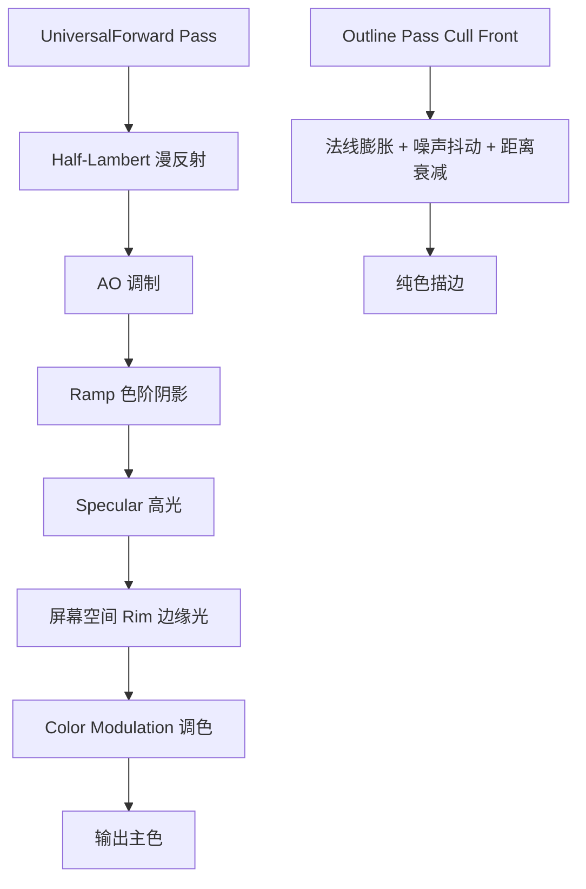

# ZZZ 角色 Toon Shader —— 设计思路总结

> 本文件归纳项目内手写 URP 卡通着色器的整体设计，便于复习与接手。
> 核心文件：`Assets/Shader/ZZZ_body.shader`、`Assets/Shader/ZZZ_face.shader`
> 配套工具：`Assets/Editor/RampEditorWindow.cs`（Ramp 贴图生成器）、`Assets/Editor/Gethuidu.cs`（顶点色查看）

---

## 0. 设计目标

面向《绝区零》风格角色（MMD 导入模型）的二次元卡通渲染，目标效果：

- **硬边 + 多级色阶阴影**（非平滑渐变），用 Ramp 贴图统一控制明暗色相；
- **屏幕空间轮廓感边缘光**（Rim），且不被模型内部杂乱法线污染；
- **像素级、分辨率无关、可调抖动的描边**（Outline）；
- **美术可驱动**：阈值、软硬、强度、颜色全部暴露为材质参数 + Ramp 贴图工作流。

---

## 1. 渲染管线与整体架构

| 项 | 选择 | 原因 |
|---|---|---|
| 管线 | URP (Universal Render Pipeline) | 手写 `HLSLINCLUDE` 公共块，仅包含 `Core/Lighting/DeclareDepthTexture` 三个库 |
| 着色器 | 纯手写 HLSL（非 ShaderGraph） | 精细控制 Ramp / 屏幕深度 Rim / 描边膨胀 |
| Pass 数 | **2 Pass**：Forward + Outline | 主色与描边分离，描边用 `Cull Front` 背面膨胀法 |
| 着色器拆分 | `ZZZ_body` / `ZZZ_face` 分离 | 身体走完整管线（Ramp/Rim/Specular），脸部走简化管线（仅 Half-Lambert + 描边） |
| SRP 兼容 | 所有材质参数包进 `CBUFFER_START(UnityPerMaterial)` | 保证 SRP Batcher 合批，避免逐材质 SetPass 开销 |
| 关键字 | `_USE_RAMPMAP`、`_USE_RIM_LIGHT`、`_USE_AO_MAP` 用 `shader_feature_local` | 变体按需编译，无 Ramp 时零成本 |

**Pass 结构（Body）**



---

## 2. 光照模型：Half-Lambert + 幂次 Toon 化

漫反射不使用标准 Lambert，而采用 **Half-Lambert（半兰伯特）** 把背光面也提亮，再用幂次把过渡"压硬"成卡通色阶：

```hlsl
half NdotL       = saturate(dot(N, L));
half halfLambert = saturate(NdotL * 0.5 + 0.5);   // 值域 [0,1]，背光面不再纯黑
halfLambert      = halfLambert * halfLambert;     // Body：平方（^2），增强对比
// Face：halfLambert = halfLambert * halfLambert * halfLambert;  // 立方（^3），更"硬"
```

**设计要点**：幂次越高，明暗交界越锐利、中间调越少，越接近赛璐璐。Body 用 ^2 保留皮肤过渡，Face 用 ^3 让面部阴影更干净（面部通常不做 Ramp，靠 ^3 的硬过渡 + 单独描边区分）。

---

## 3. 核心系统：Ramp 色阶阴影

这是整套设计的灵魂——用**一张二维 Ramp 贴图**同时编码「光照梯度」与「材质/部位分层」。

### 3.1 二维 Ramp 贴图的 UV 语义

```
RampMap (横向 U × 纵向 V)
  U 轴 = 光照强弱（从暗到亮），由 smoothstep 生成
  V 轴 = 色阶层 / 部位 ID，由 RampID 遮罩选择
```

- **横向 U（rampU）**：由 Half-Lambert 经 smoothstep 得到，控制阴影边界的**软硬**：
  ```hlsl
  half rampU = smoothstep(_ShadowThreshold - _ShadowSoftness,
                          _ShadowThreshold + _ShadowSoftness,
                          halfLambert);
  ```
  `_ShadowThreshold` 是明暗交界位置，`_ShadowSoftness` 越小边界越硬（卡通感越强）。

- **纵向 V（rampV）**：由 **RampID 遮罩贴图** 的 RGB 通道查表得到。RampID 是一张手绘遮罩，不同颜色区域代表不同阴影层级：

  ```hlsl
  half GetrampV(half3 rampIDtu)
  {
      half v = 0.1;                                    // 默认层
      v = lerp(v, 0.9, step(0.6, rampIDtu.r));         // R 通道 → 顶层
      v = lerp(v, 0.5, step(0.6, rampIDtu.g));         // G 通道 → 中层
      v = lerp(v, 0.3, step(0.6, rampIDtu.b));         // B 通道 → 底层
      return v;
  }
  ```
  即：RampID 的 **R>0.6** 选 V=0.9 行、**G>0.6** 选 V=0.5、**B>0.6** 选 V=0.3，否则用默认 V=0.1。这样美术可以在 RampID 贴图上用纯色笔刷把角色不同部位（头发/身体/衣服）指向 Ramp 贴图不同行的配色，实现**一贴图多套阴影色**。

### 3.2 合成

```hlsl
half3 RampID     = SAMPLE_TEXTURE2D(_RampID, sampler_RampID, i.uv0);
half2  rampUV    = half2(rampU, GetrampV(RampID));
half3  rampColor = SAMPLE_TEXTURE2D(_RampMap, sampler_RampMap, rampUV).rgb;
// 用 Ramp 颜色对主色做阴影调色，_ShadowIntensity 控制强弱
color = lerp(color, color * rampColor, _ShadowIntensity);
```

### 3.3 AO 与阴影的耦合

```hlsl
half ao     = SAMPLE_TEXTURE2D(_AOMap, sampler_AOMap, i.uv0);
ao          = lerp(1.0, ao, _AOIntensity * _UseAOMap);   // 1=无AO，ao 越小遮蔽越强
half ambient = halfLambert * ao;
half shadow  = (ambient + halfLambert) * 0.5;            // AO 与光照各半混合
shadow       = lerp(shadow, 0,  step(shadow, 0.05));     // 压死暗部
shadow       = lerp(shadow, 1,  step(0.95, shadow));     // 提亮亮部
```

### 3.4 Ramp 贴图生成器（工具）

`Assets/Editor/RampEditorWindow.cs` 提供 `Tool/Ramp Generator` 菜单，用 `Mathf.SmoothStep` 在 `width ± softness` 区间做横向过渡，按 `Light/Shadow` 两色 `Lerp` 生成 `Assets/TEXTURES/ramp.png`。设计意图：让美术**不进 PS** 就能快速试不同阈值/软硬的 Ramp。

---

## 4. 高光 Specular

走**贴图驱动的高光区域 + 阈值截断**，而非物理高光模型：

```hlsl
if (halfLambert > 1 - _SpecularRegion)   // 只在亮区 > (1-Region) 出现高光
{
    color.rgb = lerp(color.rgb,
                     lerp(color.rgb, color.rgb + specularMap.a, halfLambert),
                     _SpecularPower);
}
```
- `SpecularMap.a`：高光形状遮罩（白=有高光区域）；
- `_SpecularRegion`：高光覆盖范围（越大越广）；
- `_SpecularPower`：高光强度。

---

## 5. 屏幕空间深度边缘光 Rim（关键创新点）

不是传统「菲涅尔 × 阈值」的 Rim，而是**在屏幕空间做深度边缘检测**，能贴着模型与背景/自身交界的轮廓发光，且用菲涅尔做二次遮罩剔除内部杂光。

```hlsl
// 1. 观察空间下，沿法线 XY 偏移一个采样点
float3 samplePositionVS = float3(positionVS.xy + normalVS.xy * _RimWidth, positionVS.z);
// 2. 偏移点 → 裁剪 → 视口 UV
float4 samplePositionCS = mul(UNITY_MATRIX_P, float4(samplePositionVS, 1.0));
float4 samplePositionVP = TransformHClipToViewPortPos(samplePositionCS);
// 3. 采样偏移处深度（SAMPLE_TEXTURE2D_X 兼容 VR）
float offsetDepth       = SAMPLE_TEXTURE2D_X(_CameraDepthTexture, sampler_CameraDepthTexture, samplePositionVP.xy).r;
float linearEyeOffsetDepth = LinearEyeDepth(offsetDepth, _ZBufferParams);
// 4. 自身深度
float linearEyeDepth    = LinearEyeDepth(i.positionCS.z, _ZBufferParams);
// 5. 深度差判定：偏移处比自身"远" → 说明法线那侧是空洞/背景 → 判定为轮廓
float depthDiff     = linearEyeOffsetDepth - linearEyeDepth;
float rimIntensity  = step(_DepthThreshold, depthDiff);

// 6. 菲涅尔遮罩：剔除朝向相机的内部面（避免身体中间也发光）
float3 viewDirectionWS = SafeNormalize(GetCameraPositionWS() - i.positionWS);
float rimRatio = 1.0 - saturate(dot(viewDirectionWS, i.normalWS));
rimRatio       = pow(rimRatio, exp2(lerp(4.0, 0.0, _FresnelMask)));
rimIntensity   = lerp(0.0, rimIntensity, rimRatio);

color.rgb += _RimColor.rgb * rimIntensity * _RimIntensity;
```

**参数语义**
- `_RimWidth`：观察空间采样偏移量（探测半径）；
- `_DepthThreshold`：深度差阈值，越小越容易触发（轮廓越粗）；
- `_FresnelMask`：0=强菲涅尔（只留最边缘），1=弱菲涅尔（内部也允许发光）；
- `_RimColor` / `_RimIntensity`：颜色与强度。

> 设计优势：相比纯菲涅尔 Rim，这种方法在**角色被自身四肢遮挡**的轮廓处也能正确描出边缘光，且不会在正面平坦区域乱发光。

---

## 6. 描边系统 Outline（背面膨胀法）

经典 **Cull Front + 法线外扩**，但做了四层精细化：

### 6.1 像素级宽度（分辨率无关 + 宽高比修正）

```hlsl
float2 extent = normalize(normalVS.xy) * outlineWidth;
extent /= _ScreenParams.xy * 0.5;        // 像素偏移 → NDC 偏移，修正屏幕宽高比
o.positionCS.xy += extent * o.positionCS.w * clampW;  // ×w 从 NDC 还原到裁剪空间
```
关键点：除以 `_ScreenParams.xy*0.5` 保证**不同分辨率下描边粗细一致**，且横纵不拉伸。

### 6.2 顶点色 G 通道粗细遮罩

用顶点色（Vertex Color）的 **G 通道** 控制局部描边粗细，实现「硬边/软边」分区（如眼睛内轮廓、嘴唇线）：

- **Body**：`outlineWidth = _OutlineWidth * lerp(0.3, 1.0, color.g) * noiseFactor`
  —— G=0 仍保留 0.3 倍基础描边（不会完全消失）；
- **Face**：`outlineWidth = _OutlineWidth * color.g * noiseFactor`
  —— G=0 直接无描边（面部内描边靠顶点色精确控制）。

### 6.3 Perlin 噪声抖动（手绘感）

```hlsl
float2 noiseUV = v.uv0 * _NoiseTillOffset.xy + _NoiseTillOffset.zw
                 + _Time.y * _OutlineNoiseAnimSpeed;        // 沿对角线滚动 UV
float noiseFactor = 1.0 + perlinNoise2D(noiseUV) * _OutlineNoiseStrength;
```
`noiseFactor ∈ [1-strength, 1+strength]`，让描边粗细随机起伏，模拟手绘 ink 抖动。`_NoiseTillOffset` 对齐 Unity Tiling/Offset 用法；`_OutlineNoiseAnimSpeed>0` 时描边"流动"。

### 6.4 距离衰减 + Z 偏移

```hlsl
float clampW = clamp(_OutlineMaxDistance / o.positionCS.w, 0.0, 1.0);  // 远处自动变细
o.positionCS.z += -_OutlineZOffset;   // URP Reverse-Z：正值沉后，负值前移，防穿模
```
- `_OutlineMaxDistance`：衰减起点（米），该距离内满粗细，超出按 `MaxDist/w` 衰减；
- `_OutlineZOffset`：微调描边与主体深度关系，避免描边被主体遮挡闪烁。

---

## 7. 调色 Color Modulation

```hlsl
_ColourModulation  // 整体乘色（改色调，如偏暖/偏冷）
_Saturation        // 饱和度，Range(0,2)，1=原色
```
放在主色合成之后、输出之前，作为最后的统一校色层。

---

## 8. Perlin 噪声实现（轻量版）

用于描边抖动的 2D 梯度噪声，**为 SM2.0 / 移动端友好**而设计：

```hlsl
float2 hash22(float2 p)            // sin 哈希生成梯度（未归一化，幅度略不均但描边够用）
{
    p = float2(dot(p, float2(127.1, 311.7)), dot(p, float2(269.5, 183.3)));
    return -1.0 + 2.0 * frac(sin(p) * 43758.5453123);
}

float perlinNoise2D(float2 p)
{
    float2 pi = floor(p), pf = frac(p);
    float2 u  = pf*pf*pf*(pf*(pf*6.0 - 15.0) + 10.0);   // quintic（C²）衰减，消除网格接缝
    // 四角梯度点积 + 双线性插值
    ...
    return lerp(lerp(n00, n10, u.x), lerp(n01, n11, u.x variant), u.y);
}
```
**要点**：用 **quintic 权重** `6t⁵-15t⁴+10t³` 而非 `smoothstep(3t²-2t³)`，保证二阶连续，避免噪声网格可见接缝。

---

## 9. 调试与工具链

| 工具 / 参数 | 位置 | 用途 |
|---|---|---|
| `_DebugNoise` | Body/Face Shader | =1 时片段直出 Perlin 噪声灰度图，检查描边抖动图案 |
| 顶点色直出 | frag 注释分支 `return half4(vertexcolor.ggg,1)` | 调试顶点色分布 |
| `Gethuidu.cs` (`Tools/Vertex Color/Print Selected Mesh Colors`) | Editor | 打印选中 Mesh 顶点色 RGBA，统计 G 通道取值（校准描边遮罩） |
| `RampEditorWindow.cs` (`Tool/Ramp Generator`) | Editor | 可视化生成 `ramp.png`（SmoothStep 横向过渡 + 双色 Lerp） |

---

## 10. 关键材质参数速查（Body）

| 参数 | 类型 | 含义 |
|---|---|---|
| `_BaseMap` | 2D | 基础色贴图 |
| `_AOMap` / `_AOIntensity` / `_UseAOMap` | 2D / F / Toggle | AO 贴图与强度 |
| `_SpecularMap` / `_SpecularPower` / `_SpecularRegion` | 2D / F / F | 高光遮罩 / 强度 / 范围 |
| `_RampMap` / `_RampID` / `_UseRampMap` | 2D / 2D / Toggle | Ramp 色阶图 / 部位遮罩 / 开关 |
| `_ShadowThreshold` / `_ShadowSoftness` / `_ShadowIntensity` | F / F / F | 明暗交界位置 / 软硬 / 强度 |
| `_RimIntensity` / `_RimColor` / `_RimWidth` / `_DepthThreshold` / `_FresnelMask` | F / C / F / F / F | 边缘光全套 |
| `_ColourModulation` / `_Saturation` | C / F | 校色调色 |
| `_OutlineWidth` / `_OutlineColor` / `_OutlineMaxDistance` / `_OutlineZOffset` | F / C / F / F | 描边全套 |
| `_NoiseTillOffset` / `_OutlineNoiseStrength` / `_OutlineNoiseAnimSpeed` / `_DebugNoise` | V4 / F / F / F | 描边噪声抖动 |

---

## 11. 一句话设计哲学

> **「用数据驱动替代硬编码」**：明暗色阶交给 Ramp 贴图、部位分层交给 RampID 遮罩、描边粗细交给顶点色 G 通道、抖动交给 Perlin 噪声。着色器本身只负责「正确的数学」（Half-Lambert、屏幕深度差、NDC 像素对齐），美术在贴图与参数里完成全部风格表达——这正是二次元 Toon 渲染可维护性的关键。
